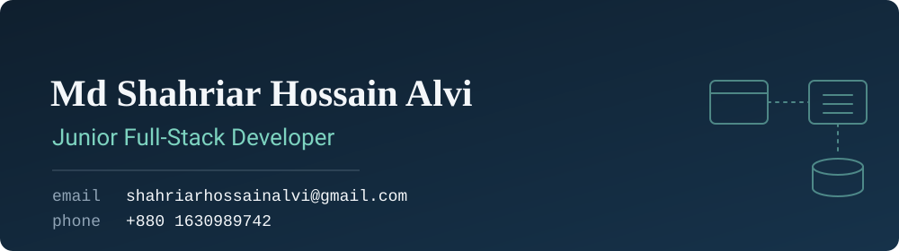
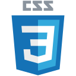
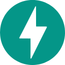
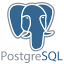
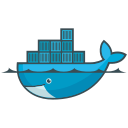
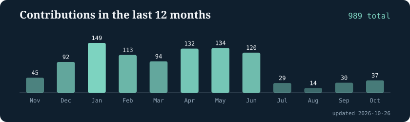

<h3 align="center">I am a junior full-stack developer. On the front end I build with HTML5, CSS3, JavaScript, React, Tailwind CSS. On the back end I build server-side applications with FastAPI, Express.js and work with MongoDB, PostgreSQL, SQLAlchemy ORM and Docker.</h3>

- 🌱 I'm currently learning **Next.Js, TypeScript, NestJs, Prisma**

- 📫 How to reach me **shahriarhossainalvi@gmail.com**
- 👨‍💻 All of my projects are available at **https://sh-alvi.vercel.app**
- 📄 Know about my experiences **https://drive.google.com/file/d/1_iPHkToNzx47hAFydLOmrP2u7Kn5j11j/view**

 

<h3 align="left">Languages and Tools:</h3>

<h2 align="left">⚡Activity Graph:</h2>

